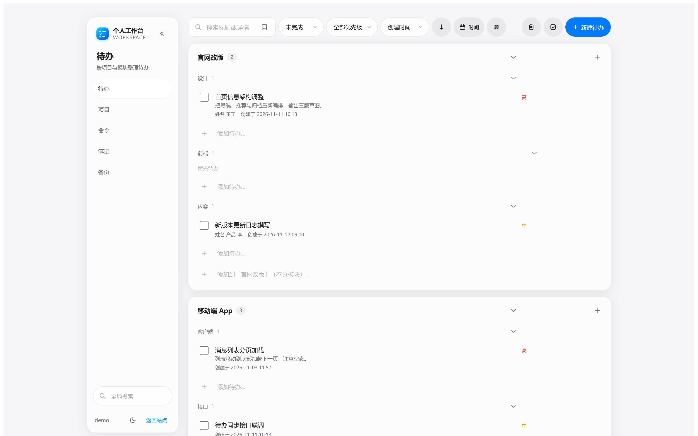
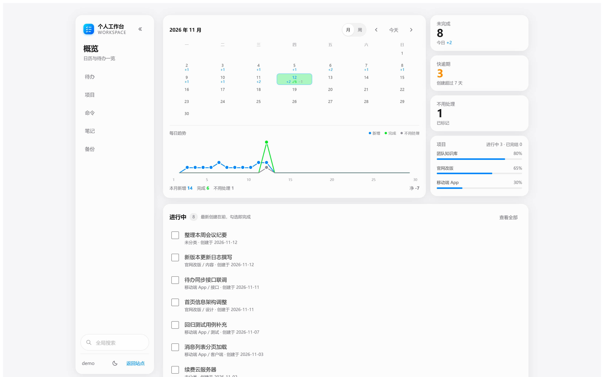
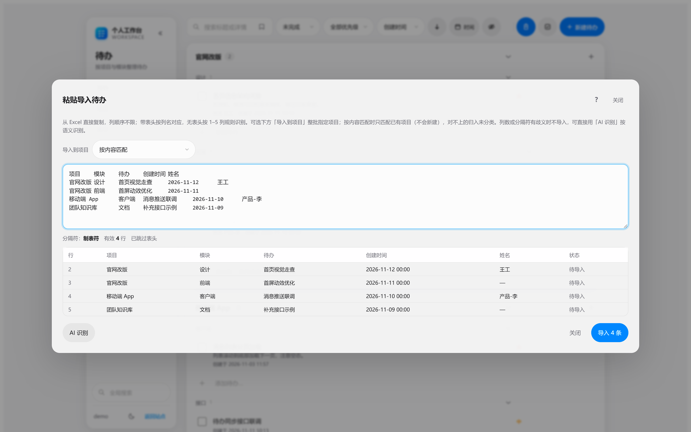
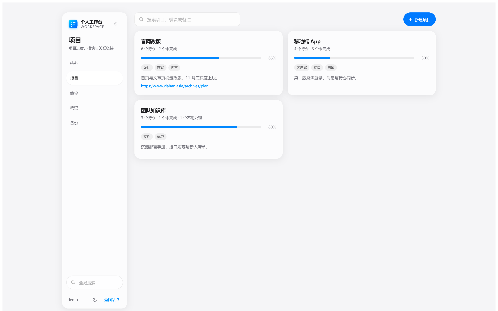
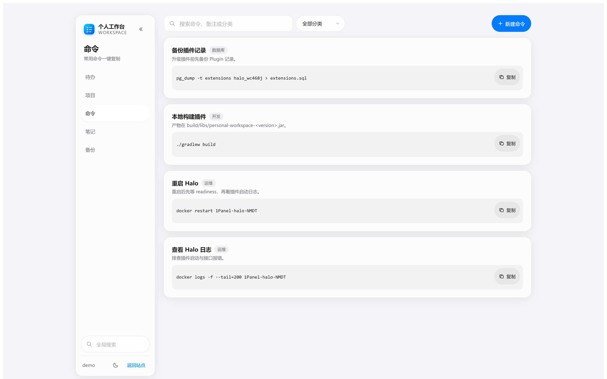
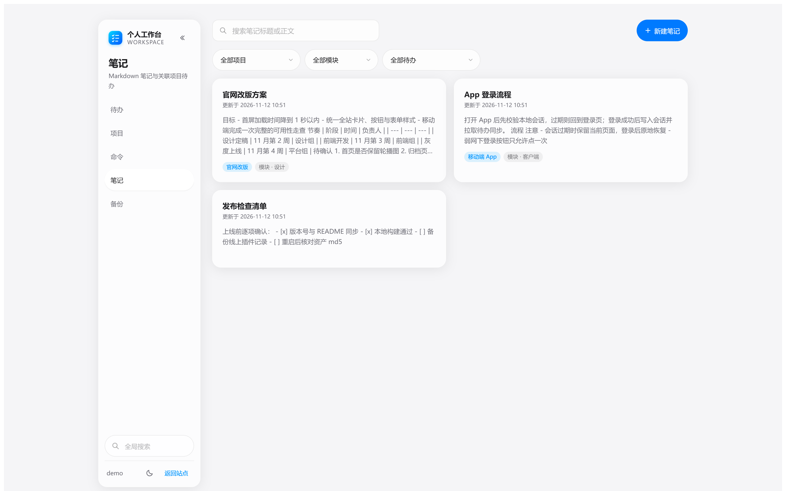
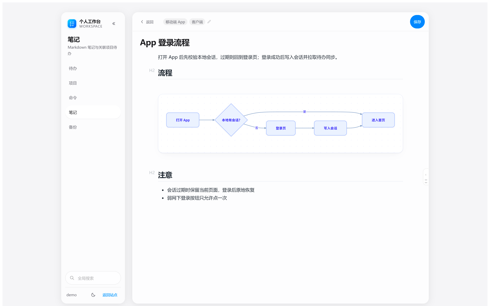
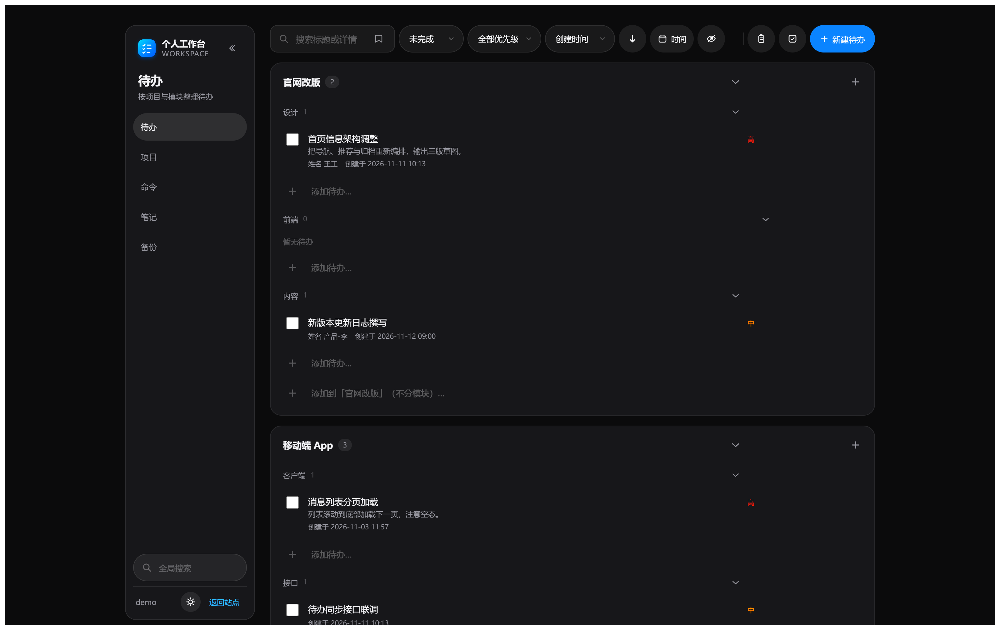

# 个人工作台（personal-workspace）

Halo 2.26+ 的前台个人工作台插件：把待办、项目、快速命令与笔记收进一个页面，所有数据按登录用户隔离。入口 `/workspace`，不进入 Console。

后端 Java 21 + WebFlux，前端 Vue 3 + Vite + Tailwind，笔记编辑器使用 Vditor。

当前版本：`0.6.73`



## 功能

### 概览



- 登录后默认进入概览页，点左上角「个人工作台」随时回到首屏
- 日历按月 / 按周切换，按天显示新增、完成与不用处理数量，可翻页、一键回到今天
- 右侧卡片：未完成（含「今日 +N」）、快逾期（创建超过 7 天仍未完成）、不用处理、项目进度；点击卡片直接跳到对应筛选
- 日历下方折线图与日历共用月 / 周视图，悬停显示当天的新增 / 完成 / 不用处理数量
- 「进行中」列出最新创建的 8 条未完成待办，勾选即完成；点行进待办页并带入项目筛选

### 待办

- 默认只显示未完成，但保留全部项目与模块（0 条也显示），方便直接新建或编辑
- 创建、编辑、删除，勾选完成，标记 / 恢复「不用处理」；优先级、项目 / 模块、姓名、创建时间、截止日期都可编辑
- 点击整行打开编辑；多选态下点击改为勾选，选中整块浅蓝底
- 关键词搜索，状态 / 优先级 / 创建 / 完成时间筛选，按创建 / 完成 / 截止时间与优先级排序，全部在前端即时生效
- 分组按项目与模块展示：整行点击即筛选，标题右侧箭头折叠 / 展开，分组悬停「全部完成」
- 模块底部与项目卡片底部有幽灵输入行，输入回车即创建待办，失焦自动保存，可连续添加
- 多选后工具条收拢为「批量操作」菜单：标记完成 / 标记不用处理 / 移动到… / 删除所选 / 清除选择；旁边的「复制」菜单可选复制完整信息或仅复制标题
- 进度 100% 的项目默认隐藏，工具栏眼睛按钮可切换；待办行可跳转或新建关联笔记
- 保存筛选视图：把当前关键词、状态、优先级、项目 / 模块与时间区间存成命名视图，搜索框内的书签按钮一键恢复，视图保存在当前浏览器

### 导入



- 从 Excel 直接粘贴，支持 1–5 列：待办；项目 + 待办 / 模块 + 待办；项目 + 模块 + 待办；再追加创建时间、姓名
- 带表头时按列名自动对应，列顺序随意；自动识别制表符、竖线、连续空格、逗号等分隔符
- 列数或分隔符有歧义时拒绝导入并说明原因，不会猜
- 可整批指定「导入到项目」；导入只匹配已有项目，不会新建，对不上的归入未分类
- 导入前显示逐行预览与问题提示，一次最多 500 行

AI 识别导入（需在插件设置中配置 OpenAI 兼容接口）：

- 由模型按语义判断项目 / 模块 / 待办 / 创建时间 / 姓名列，列顺序打乱、表头缺失也能识别
- 功能名与问题描述合并成一句能独立看懂的标题，补充信息才写入详情，可适度总结提炼、分点排版
- 按业务分区归并已有模块，同义 / 简称 / 全半角 / 通用后缀差异会尽量对上现有名称
- 内容较多时按约 40 行自动分批，单批失败自动重试一次，最后合并成一页可编辑预览
- API Key 只保存在服务端，文本由服务端发往所配置的接口

### 项目



- 卡片展示进度、待办统计、模块、备注与关联链接
- 新建 / 编辑 / 删除；模块可增删改名，改名时服务端原子迁移该项目下引用旧名的待办
- 卡片悬停可查看关联笔记或待办

### 快速命令



- 按分类筛选与搜索，命令块一键复制，支持增删改

### 笔记



- 页内 Markdown 编辑器（Vditor IR 模式），标题与正文直接铺开，停顿自动保存，`Ctrl/Cmd + S` 立即保存并返回
- 右侧标题大纲默认收起为贴边轨道，悬停展开，可固定成悬浮卡片
- Mermaid 代码块（`` ```mermaid ``）直接渲染为 SVG，样式与前台文章一致，切换深浅色时按主题重绘
- 支持表格、行内 HTML 预览；粘贴或拖入图片自动上传为站点附件并插入 Markdown
- 可关联项目、模块与多个待办；「属性」弹窗编辑关联，不打断正文
- 点击卡片直接打开编辑；卡片上的项目 / 模块 / 待办标签可跳到项目页、该模块待办或具体待办（多个待办时先选一个）



### 搜索与备份

- 左侧栏底部全局搜索跨待办、项目、命令、笔记，点击结果跳到对应页面并带入关键词
- 备份导出全部数据为 JSON；导入支持合并与覆盖（覆盖前二次确认），保留完成时间、不用处理状态、项目进度与笔记关联

### 外观与操作

- 苹果 HIG 视觉：毛玻璃卡片、18px 圆角、胶囊按钮、最小 44px 点击区
- 深色 / 浅色主题默认跟随系统，可手动切换并记住偏好
- 桌面端侧栏可折叠，偏好写入本地存储；移动端单列布局
- 工具区可整块折叠（搜索、筛选、排序、操作按钮），快捷键在插件设置中配置，默认按顺序输入 `z+d+v`
- 各页数据内存缓存，切换页面先显示上次内容再静默刷新



## 安装

构建需要 JDK 21、Node 20。前端由 Gradle 自动构建并打包进 jar。

```bash
./gradlew build
# 产物：build/libs/personal-workspace-0.6.73.jar
```

打开 Halo Console →「插件 → 安装」，上传 jar 并启用，然后访问 `/workspace`。

本地起一个 Halo 调试：

```bash
./gradlew haloServer   # 默认 8090
```

Windows 下如果工作目录被解析成盘符路径导致 R2DBC 报错，用显式路径启动：

```bash
java -jar halo.jar --halo.work-dir=D:/path/to/work
```

仅调试前端：

```bash
cd ui
pnpm install
pnpm run dev      # 热更新，接口仍指向 Halo 站点
pnpm run typecheck
pnpm run build    # 先复制 Vditor 静态资源，再构建 ui/build/dist
```

## 配置

插件设置页（Console → 插件 → 个人工作台 → 设置）包含：

- **基础设置**：整块折叠快捷键，默认 `z+d+v`
- **AI 识别**：接口地址（Base URL，如 `https://api.deepseek.com/v1`，无需带 `/chat/completions`）、模型名、API Key；任意 OpenAI 兼容接口均可，留空则关闭 AI 识别，规则导入照常使用

## 安全模型

优先级：安全 > 功能 > UI。

- **认证**：`/apis/api.workspace.halo.run/**` 由 `WorkspaceApiAuthFilter` 先加载会话，未登录直接返回 401 JSON，不重定向；只有页面 `/workspace` 会 302 到登录页
- **所有者隔离**：唯一数据访问层 `WorkspaceDataAccess`，所有查询附加 `spec.owner = 当前用户`；请求体里的 `owner` 一律丢弃
- **权限**：业务读写全部走自定义 `CustomEndpoint`；角色模板 `personal-workspace-authenticated` 只聚合到已登录角色，不授予 automatic CRD 接口权限
- **CSRF**：沿用 Halo 原生机制，`/apis` 路径由 Halo 的 CsrfConfigurer 豁免，依赖 `SameSite` 会话 Cookie
- **校验**：DTO 显式校验；请求体上限 待办 / 项目 / 命令 64KB、笔记 256KB、图片 8MB、备份 8MB；笔记正文 ≤200000 字符
- **破坏性操作**：所有 DELETE 必须带 `confirm=true`，备份覆盖导入必须传 `replace=true` 并二次确认
- **内容安全**：笔记图片只接受 `image/*`；项目链接只放行 http/https 与站内相对路径
- **已知边界**：Halo 超级管理员天然拥有全部 CRD 权限，这是平台设计；普通登录用户不具备

## API

Base：`/apis/api.workspace.halo.run/v1alpha1`，所有响应带 `Cache-Control: no-store`。

| 方法 | 路径 | 说明 |
| --- | --- | --- |
| GET | `/todos` | 列表，参数 `q`、`status=all\|open\|done\|dismissed`、`priority`、`page`、`size`（默认 20，上限 500） |
| GET | `/todos/{name}` | 详情，非本人数据 404 |
| POST | `/todos` | 创建 |
| PUT | `/todos/{name}` | 更新 |
| DELETE | `/todos/{name}?confirm=true` | 删除，缺少 `confirm` 返回 400 |
| GET | `/projects` | 项目列表，按创建时间升序 |
| POST | `/projects` | 创建项目 |
| PUT | `/projects/{name}` | 更新项目；未传的进度 / 备注 / 链接保持原值 |
| PUT | `/projects/{name}/modules/rename` | 重命名模块，body `{from,to}`，原子迁移引用旧名的待办 |
| DELETE | `/projects/{name}?confirm=true` | 删除项目；项目下仍有待办返回 409 |
| GET | `/commands` | 命令列表，按创建时间倒序 |
| POST | `/commands` | 创建命令 |
| PUT | `/commands/{name}` | 更新命令 |
| DELETE | `/commands/{name}?confirm=true` | 删除命令 |
| GET | `/notes` | 笔记列表，含正文、关联与更新时间 |
| POST | `/notes` | 创建笔记 |
| PUT | `/notes/{name}` | 更新笔记，服务端刷新 `updatedAt` |
| DELETE | `/notes/{name}?confirm=true` | 删除笔记 |
| POST | `/images` | 上传笔记图片（multipart `file`），返回 `{url}` |
| GET | `/search?q=` | 跨待办 / 项目 / 命令 / 笔记搜索，每类最多 8 条 |
| GET | `/backup` | 导出当前用户全部数据 |
| POST | `/backup?replace=true\|false` | 导入备份 |

AI 识别走页面接口：`POST /workspace/api/ai-import`，body `{text}`（≤20000 字符），会话鉴权并校验 CSRF；未配置返回 503，模型报错 502，超时 504。

请求体字段：

- 待办：`title`（必填 ≤200）、`detail`（≤5000）、`priority`（必填 `HIGH/MEDIUM/LOW`）、`project`、`module`（≤32）、`dueDate`、`completed`、`dismissed`、`createdAt`、`reporter`；`completedAt` / `dismissedAt` 由服务端维护
- 项目：`title`、`modules`（≤20）、`progress`（0–100）、`note`、`links`（≤20）、`tags`（≤10）
- 命令：`title`、`command`（≤5000）、`note`、`category`、`tags`
- 笔记：`title`、`content`（≤200000）、`project`、`module`、`todos`（≤50）、`tags`

错误统一为 `{"error":{"code":"...","message":"..."}}`：400 参数错误、401 未登录、404 不存在或非本人、409 冲突、413 请求体过大、500 服务异常。

## 数据模型

4 个 `workspace.halo.run/v1alpha1` CRD，`spec.owner` 存 Halo 用户名：

| Kind | 用途 | 索引 |
| --- | --- | --- |
| WorkspaceTodo | 待办（项目、模块、完成 / 不用处理时间） | owner、completed、dismissed、priority、dueDate、title、detail、tags |
| WorkspaceProject | 项目（模块、进度、备注、链接） | owner |
| WorkspaceQuickCmd | 快速命令（命令、分类） | owner |
| WorkspaceNote | 笔记（Markdown 正文、关联、更新时间） | owner |

索引在 `PersonalWorkspacePlugin.start()` 注册、`stop()` 注销。笔记图片作为站点附件存储，正文只记 URL。

## 后续扩展

命令变量、拖拽排序与跨设备同步筛选视图属于可选增强，不影响当前功能闭环。
